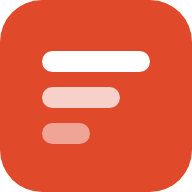
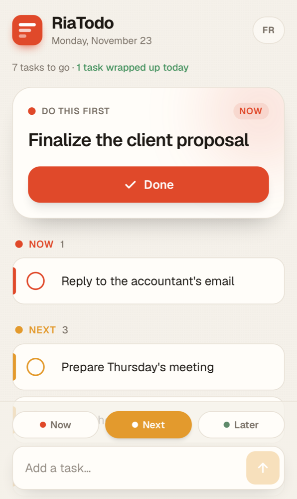
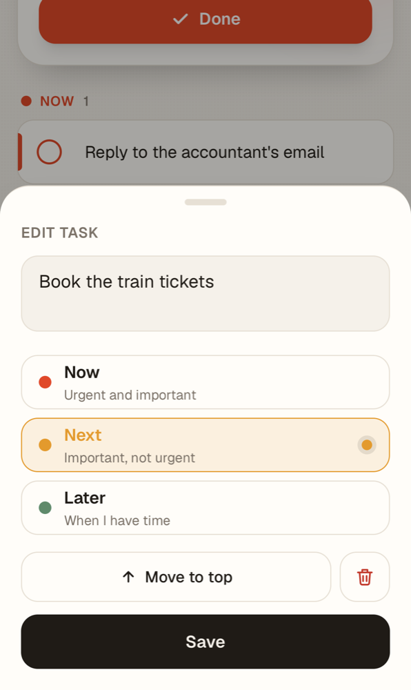
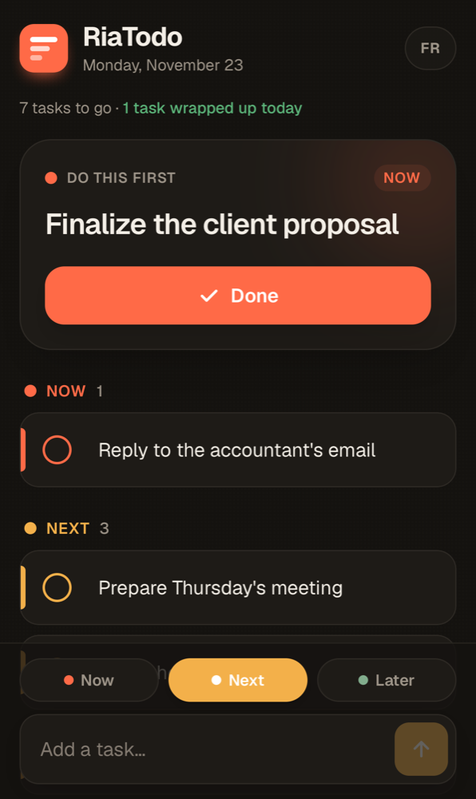

<div align="center">



# RiaTodo

**Your priorities, at a glance.**

A to-do list built for your phone: three priority levels, one task in the spotlight, nothing extra.

[**Open the app**](https://riatodo.vercel.app) · [Version française](README.md)


<br />


&nbsp;

&nbsp;


</div>

## Why

Most to-do apps end up abandoned because they grow too heavy: projects, labels, subtasks, dates everywhere. RiaTodo takes the opposite bet: open the app, see **the** thing to do, do it, move on to the next one.

## Features

| | |
|---|---|
| 🎯 **"Do this first" card** | The most important task is front and center, with a big "Done" button. |
| 🚦 **Three priorities, no more** | **Now** (urgent and important), **Next** (important, not urgent), **Later** (when I have time). Inspired by the Eisenhower matrix. |
| ✋ **Soft limit of 3 urgent tasks** | Beyond 3 tasks in "Now", a reminder suggests pushing one back: when everything is urgent, nothing is. |
| ⚡ **One-gesture capture** | Input at the bottom of the screen, within thumb reach. Priority in one tap, Enter to add. "Next" by default to avoid reflex urgency. |
| 👆 **Native gestures** | Swipe right to complete, left to delete, with "Undo" for a few seconds. |
| ✏️ **Quick edit** | Tap a task to rename it, change its priority, move it to the top or delete it. |
| 🧹 **Automatic cleanup** | Completed tasks are collapsed and purged after 7 days. |
| 🔒 **No account** | Everything stays in the browser (`localStorage`). No data is sent anywhere. |

## Built for mobile

- **Installable** on the home screen:
  - iPhone: Safari > Share > "Add to Home Screen"
  - Android: Chrome > menu > "Install app"
- **Works offline** thanks to the service worker (subway, plane, no signal).
- Touch targets of at least 44 px, 16 px input (no auto-zoom on iOS), notch-aware layout (`safe-area-inset`), haptic feedback on Android.
- Light or dark theme following the phone setting, animations off when "Reduce motion" is enabled.
- **French** and **English** UI (auto-detected, FR/EN toggle).

## Stack

| Layer | Choice |
|---|---|
| Framework | Next.js 16 (App Router, Turbopack) |
| UI | React 19, Tailwind CSS 4 |
| Language | TypeScript |
| Data | `localStorage` through `useSyncExternalStore`, synced across tabs |
| Offline | Hand-written service worker (`public/sw.js`) |
| Hosting | Vercel |

## Getting started

```bash
npm install
npm run dev
```

The app runs on [http://localhost:3717](http://localhost:3717). No environment variables are required.

To try it on your phone, open `http://<your-computer-ip>:3717` from the same Wi-Fi network.

## Quality

```bash
npm run lint
npm run build
```

## Deployment

The project is linked to Vercel through the GitHub integration: every push to `main` triggers a production deployment on [riatodo.vercel.app](https://riatodo.vercel.app).

## Structure

```
src/
├── app/            # layout, page, PWA manifest, global styles
├── components/     # RiaTodoApp, TaskItem (gestures), Composer, EditSheet
└── lib/
    ├── tasks.ts    # localStorage store and actions
    └── i18n.ts     # FR/EN strings
public/
└── sw.js           # service worker (offline)
```

## Roadmap

- [x] Capture, three priorities, focus card, gestures, undo
- [x] Installable, offline-ready PWA
- [x] FR/EN UI, dark theme
- [ ] Cross-device sync (only if the need becomes real)

## License

[MIT](LICENSE) · © 2026 Riadh MNASRI
