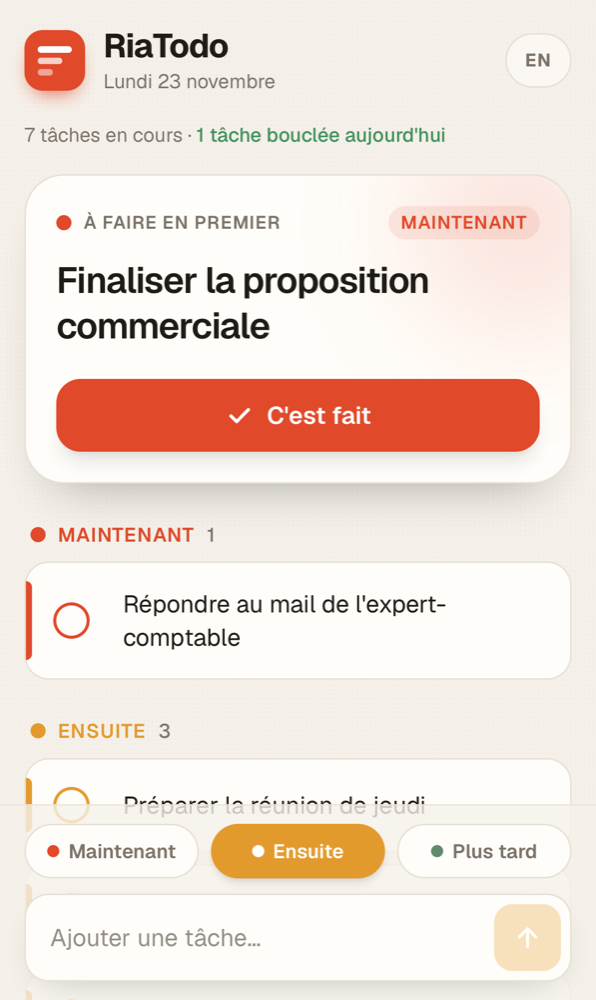
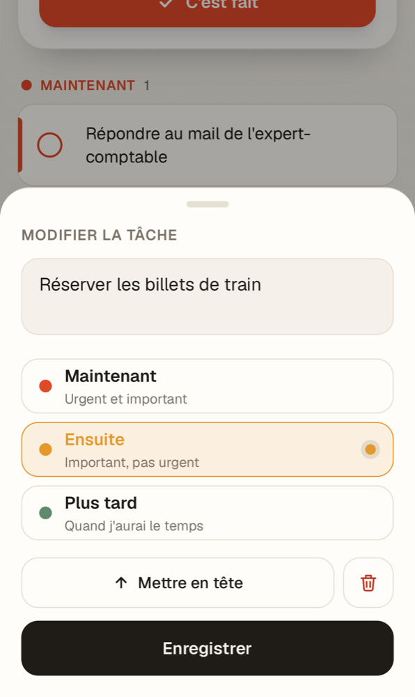

<div align="center">


# RiaTodo

**Tes priorités, en un coup d'œil.**

Une liste de tâches pensée pour le téléphone : trois niveaux de priorité, une tâche mise en avant, rien de superflu.

[**Ouvrir l'app**](https://riatodo.vercel.app) · [English version](README.en.md)


<br />


&nbsp;

&nbsp;


</div>

## Pourquoi

La plupart des applis de tâches finissent abandonnées parce qu'elles deviennent trop lourdes : projets, étiquettes, sous-tâches, dates partout. RiaTodo fait le pari inverse : on ouvre l'app, on voit **la** chose à faire, on la fait, on passe à la suivante.

## Fonctionnalités

| | |
|---|---|
| 🎯 **Carte « À faire en premier »** | La tâche la plus importante est mise en avant, avec un gros bouton « C'est fait ». |
| 🚦 **Trois priorités, pas plus** | **Maintenant** (urgent et important), **Ensuite** (important, pas urgent), **Plus tard** (quand j'aurai le temps). Inspiré de la matrice d'Eisenhower. |
| ✋ **Limite douce de 3 urgences** | Au-delà de 3 tâches en « Maintenant », un rappel invite à en repousser une : si tout est urgent, plus rien ne l'est. |
| ⚡ **Saisie en un geste** | Champ en bas de l'écran, à portée de pouce. Priorité en une touche, Entrée pour valider. « Ensuite » par défaut pour éviter l'urgence réflexe. |
| 👆 **Gestes natifs** | Glisser à droite pour terminer, à gauche pour supprimer, avec « Annuler » pendant quelques secondes. |
| ✏️ **Édition rapide** | Toucher une tâche pour la renommer, changer sa priorité, la mettre en tête ou la supprimer. |
| 🧹 **Ménage automatique** | Les tâches terminées sont repliées et purgées au bout de 7 jours. |
| 🔒 **Aucun compte** | Tout reste dans le navigateur (`localStorage`). Aucune donnée n'est envoyée nulle part. |

## Pensé pour le mobile

- **Installable** sur l'écran d'accueil :
  - iPhone : Safari > Partager > « Sur l'écran d'accueil »
  - Android : Chrome > menu > « Installer l'application »
- **Hors ligne** grâce au service worker (métro, avion, zone blanche).
- Zones tactiles de 44 px minimum, champ en 16 px (pas de zoom automatique sur iOS), prise en compte de l'encoche (`safe-area-inset`), retour haptique sur Android.
- Thème clair ou sombre selon le réglage du téléphone, animations coupées si « Réduire les animations » est activé.
- Interface en **français** et en **anglais** (détection automatique, bouton FR/EN).

## Stack

| Couche | Choix |
|---|---|
| Framework | Next.js 16 (App Router, Turbopack) |
| UI | React 19, Tailwind CSS 4 |
| Langage | TypeScript |
| Données | `localStorage` via `useSyncExternalStore`, synchronisé entre onglets |
| Hors ligne | Service worker maison (`public/sw.js`) |
| Hébergement | Vercel |

## Démarrer

```bash
npm install
npm run dev
```

L'app tourne sur [http://localhost:3717](http://localhost:3717). Aucune variable d'environnement n'est nécessaire.

Pour l'essayer sur ton téléphone, ouvre `http://<ip-de-ton-ordinateur>:3717` depuis le même réseau Wi-Fi.

## Qualité

```bash
npm run lint
npm run build
```

## Déploiement

Le projet est relié à Vercel via l'intégration GitHub : chaque push sur `main` déclenche un déploiement de production sur [riatodo.vercel.app](https://riatodo.vercel.app).

## Structure

```
src/
├── app/            # layout, page, manifest PWA, styles globaux
├── components/     # RiaTodoApp, TaskItem (gestes), Composer, EditSheet
└── lib/
    ├── tasks.ts    # store localStorage et actions
    └── i18n.ts     # textes FR/EN
public/
└── sw.js           # service worker (hors ligne)
```

## Roadmap

- [x] Saisie, trois priorités, carte de focus, gestes, annulation
- [x] PWA installable et hors ligne
- [x] Interface FR/EN, thème sombre
- [ ] Synchronisation entre appareils (uniquement si le besoin se confirme)

## Licence

[MIT](LICENSE) · © 2026 Riadh MNASRI
